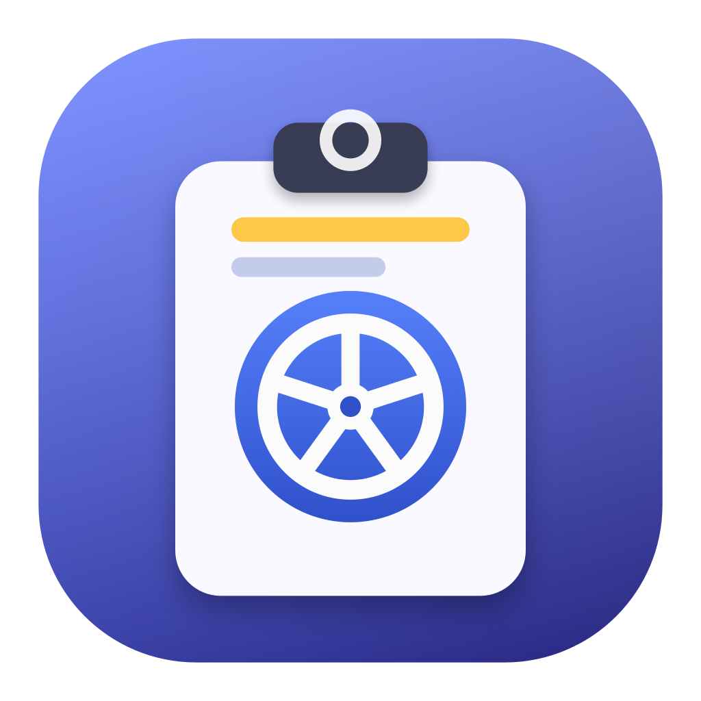
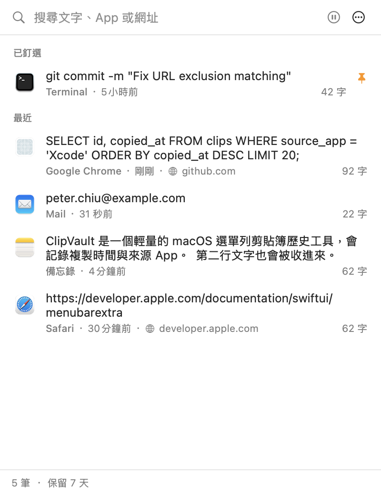
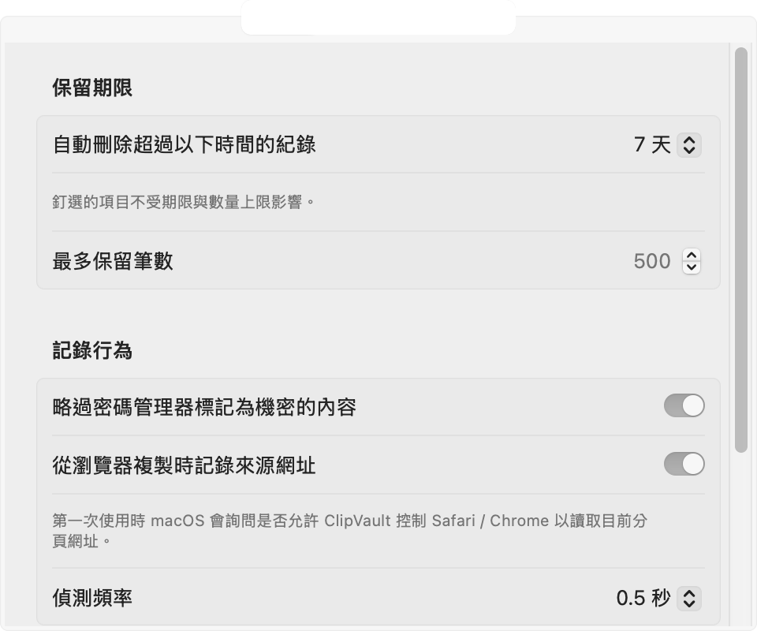
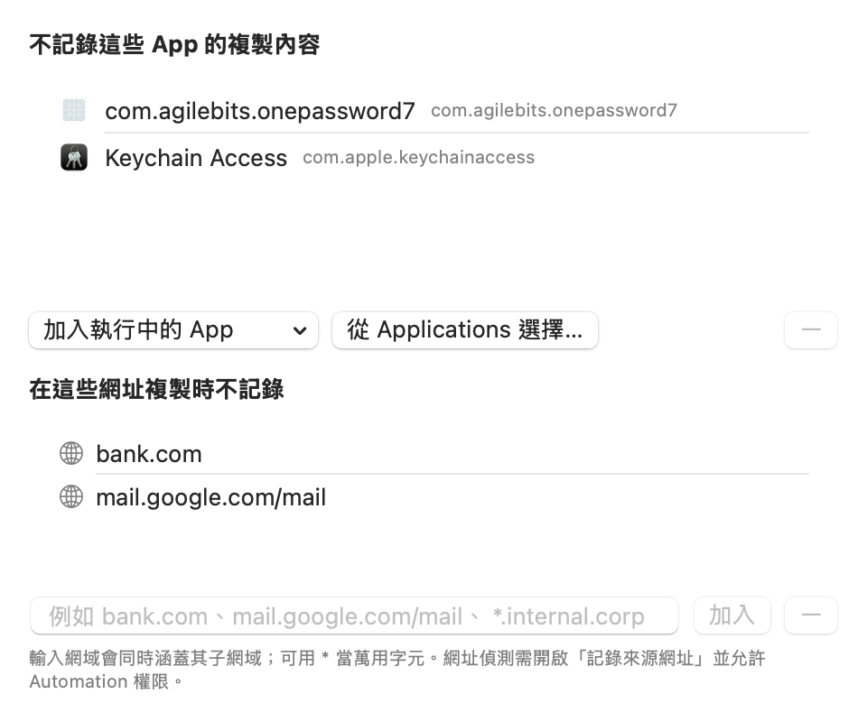

<p align="center">
  
</p>

# ClipVault

<p align="center">
  
</p>

輕量的 macOS 選單列剪貼簿歷史工具，使用 Swift / SwiftUI 撰寫，**不需要 Xcode 就能編譯**（只要 Command Line Tools）。

所有紀錄只存在本機 `~/Library/Application Support/ClipVault/history.json`，不會上傳任何資料。

## 功能

- **即時記錄**：背景監看系統剪貼簿，複製的文字立刻出現在選單列視窗。
- **複製時間**：每筆顯示相對時間（剛剛、3 分鐘前…），滑鼠停留可看完整 `yyyy/MM/dd HH:mm:ss`。
- **來源 App**：顯示複製當下最前景 App 的圖示與名稱。
- **來源網址**：從 Safari / Chrome / Arc / Edge / Brave / Vivaldi / Opera 複製時，會記錄當時分頁的網址（右鍵可直接開啟）。
- **排除規則**：
  - 指定 App（例如 1Password、Keychain Access）複製的內容永不記錄。
  - 指定網址（例如 `bank.com`、`mail.google.com/mail`、`*.internal.corp`）複製的內容永不記錄；網域規則自動涵蓋子網域。
  - 在歷史紀錄上按右鍵即可一鍵「之後不記錄這個 App / 這個網站」。
- **保留期限**：15 分鐘到 30 天，或永久保留；另有最大筆數上限。釘選的項目不會過期。
- **其他**：
  - 自動略過密碼管理器標記為機密（`org.nspasteboard.ConcealedType`）的內容。
  - 相同文字再複製一次會移到最上面而不是重複出現。
  - 搜尋文字、App 名稱或網址。
  - 釘選常用片段。
  - 一鍵暫停 / 恢復記錄。
  - 登入時自動啟動。
  - 點一下項目即複製回剪貼簿。
  - App 圖示與選單列圖示都是用 AppKit 程式繪製（`scripts/make-icon.swift`），不依賴任何設計工具。

<p align="center">
  
  
</p>

## 系統需求

- macOS 13 Ventura 或更新版本
- 編譯需要 Xcode Command Line Tools（`xcode-select --install`）；有 Xcode 當然也可以

## 編譯與安裝

```bash
git clone https://github.com/yakiniku35/ClipVault.git
cd ClipVault
make app          # 產生 universal (arm64 + x86_64) 的 build/ClipVault.app
make install      # 複製到 /Applications
open /Applications/ClipVault.app
```

其他指令：

| 指令 | 說明 |
| --- | --- |
| `make debug` | 只編譯目前架構的 debug 版 |
| `make run` | 編譯 debug 版並啟動 |
| `make test` | 執行邏輯檢查（不需要 XCTest） |
| `swift test` | 若 toolchain 支援 SwiftPM，可跑 XCTest 版測試 |
| `make clean` | 清除 build 產物 |

App 是 ad-hoc 簽章，第一次開啟若被 Gatekeeper 擋下，請在「系統設定 → 隱私權與安全性」允許，或執行：

```bash
xattr -dr com.apple.quarantine /Applications/ClipVault.app
```

### 權限

- **Automation**：第一次從瀏覽器複製時，macOS 會詢問是否允許 ClipVault 控制 Safari / Chrome，以讀取目前分頁網址。拒絕的話仍會記錄文字，只是沒有網址資訊，網址排除規則也就無法生效（可在設定裡關閉「記錄來源網址」）。
- Chromium 系瀏覽器通常會直接把來源網址放在剪貼簿裡（`org.chromium.source-url`），這種情況不需要 Automation 權限。

## 專案結構

```
Sources/ClipVault/
├── ClipVaultApp.swift          # @main、MenuBarExtra、AppDelegate
├── Models/ClipItem.swift       # 單筆紀錄
├── Settings/
│   ├── AppSettings.swift       # UserDefaults 偏好設定
│   └── RetentionPolicy.swift   # 保留期限
├── Services/
│   ├── ClipboardMonitor.swift  # 輪詢 NSPasteboard、套用排除規則
│   ├── ExclusionRules.swift    # App / 網址比對（純邏輯，可測試）
│   ├── HistoryStore.swift      # 去重、釘選、過期清理、JSON 持久化
│   └── SourceURLResolver.swift # 讀取瀏覽器分頁網址
├── Views/                      # SwiftUI 介面
└── Support/                    # 圖示快取、日期格式
Tests/
├── ClipVaultTests/             # XCTest（swift test）
└── Smoke/                      # 純 assertion 檢查（make test）
scripts/
├── build-app.sh                # 不用 Xcode 的 .app 打包流程
├── smoke-test.sh
└── make-icon.swift             # 產生 AppIcon.icns 與選單列 MenuBarIcon@{1,2}x.png
```

## 已知限制

- Firefox 沒有 AppleScript 介面，無法取得來源網址。
- 目前只記錄純文字（圖片、檔案不會記錄）。
- 沒有全域快捷鍵；請點選單列圖示開啟。

## License

MIT — 詳見 [LICENSE](LICENSE)。
